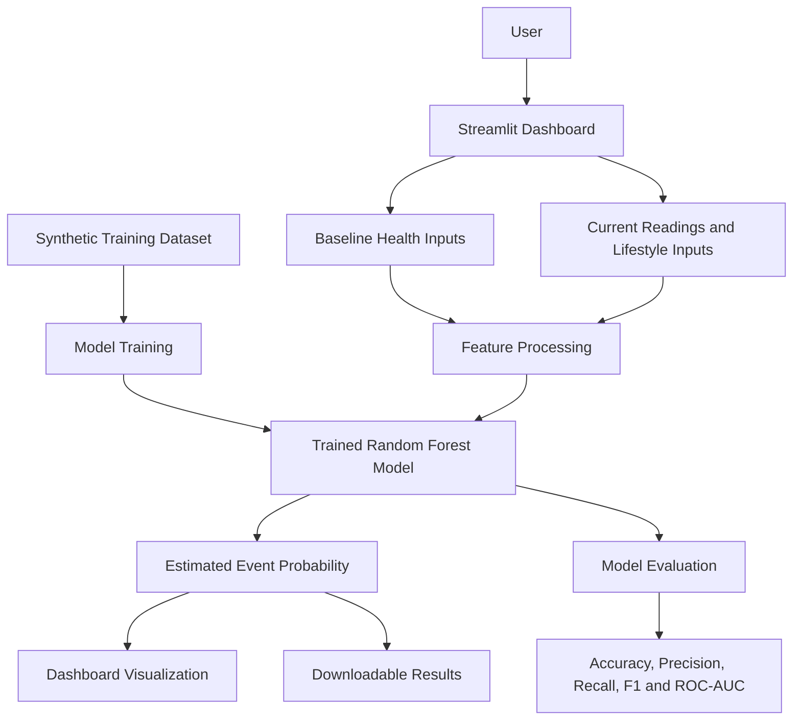

# GlucoTwin AI — System Architecture

## 1. Project Overview

GlucoTwin AI is a prototype digital-twin application designed to demonstrate how personal health information and lifestyle readings can be combined with machine learning to estimate the probability of a future glucose-related event.

The system uses baseline health information, manually entered current readings, synthetic training data, and a trained Random Forest classifier to demonstrate personalized health-risk monitoring.

## 2. System Architecture

## 3. System Components

### A. User Interface
**Technology:** Python, Streamlit

Provides an interactive dashboard where users can enter health and lifestyle information, view model output, explore visualizations, and download results.

### B. Health and Lifestyle Inputs
The prototype accepts manually entered information, including:
- Age
- Baseline glucose level
- HbA1c
- Previous diabetes status
- Current glucose reading
- Carbohydrate intake
- Steps
- Heart rate
- Heart-rate variability (HRV)
- Sleep duration
- Stress level

These inputs demonstrate how information from different health-related data streams could be combined. Live wearable-device integration is not implemented in the current prototype.

### C. Synthetic Data Generation
**Technology:** Python, NumPy, Pandas

Synthetic health and lifestyle records are generated to demonstrate model training and evaluation. The generated labels represent a simulated future glucose-related event based on the dataset's defined rules.

The dataset is for demonstration only and is not a substitute for real-world clinical data.

### D. Machine Learning Model
**Technology:** Scikit-learn, Random Forest Classifier, Joblib

The model is trained using synthetic health and lifestyle features. The trained model is saved as `model_outputs/glucotwin_model.joblib` and loaded by the Streamlit application to generate an estimated event probability.

### E. Model Evaluation
The model is evaluated on a held-out portion of the synthetic dataset using:
- Accuracy
- Precision
- Recall
- F1-score
- ROC-AUC

The evaluation results describe performance on synthetic test data only. They do not establish clinical validity or real-world predictive performance.

### F. Dashboard and Results
**Technology:** Streamlit, Plotly, Pandas

The dashboard presents the estimated event probability and illustrative glucose-related visualizations. Users can download supported results as CSV files.

## 4. Technology Stack

| Component | Technology |
|---|---|
| Programming language | Python |
| User interface | Streamlit |
| Data processing | Pandas, NumPy |
| Machine learning | Scikit-learn |
| Model storage | Joblib |
| Visualizations | Plotly |
| Dataset | Synthetic health and lifestyle data |
| Development environment | Windows, Python virtual environment |

## 5. Data Flow

1. The user enters baseline health information and current readings.
2. The application collects the inputs and prepares the model features.
3. The trained Random Forest classifier processes the features.
4. The application displays the estimated probability for the simulated event.
5. The dashboard presents visualizations and available downloadable results.
6. Separate evaluation outputs summarize model performance on synthetic test data.

## 6. Privacy, Safety and Limitations

- The current prototype uses synthetic data for model training and demonstration.
- Current readings are manually entered; live wearable or sensor integration is not implemented.
- Predictions are experimental outputs, not medical diagnoses or validated clinical risk estimates.
- The model must be validated using appropriate real-world datasets before practical healthcare use.
- Future development should include informed consent, secure data storage, privacy controls, and appropriate clinical review.

## 7. Future Enhancements

- Integrate real health datasets with appropriate permissions and safeguards.
- Connect supported wearable devices and sensor APIs.
- Develop time-series models using longitudinal health data.
- Validate performance on independent real-world datasets.
- Improve model calibration, explainability, and false-alarm monitoring.
- Add secure user profiles and privacy-aware health-data management.

---

**Project:** GlucoTwin AI  
**Team:** AI Alchemists  
**Purpose:** Demonstration of a machine-learning-based health digital-twin workflow.
